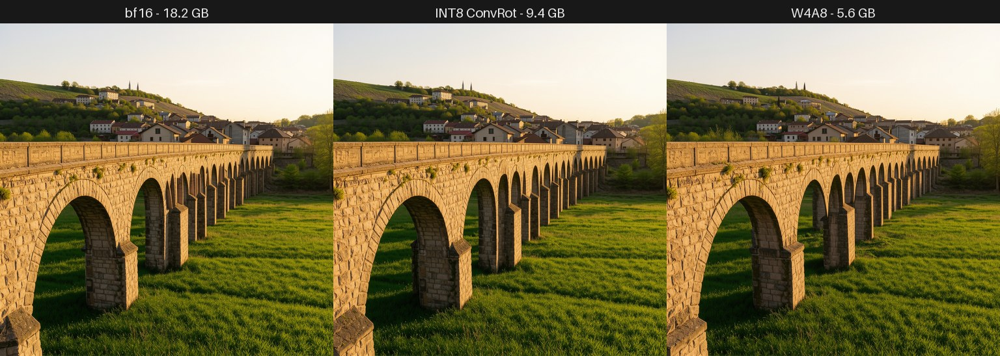
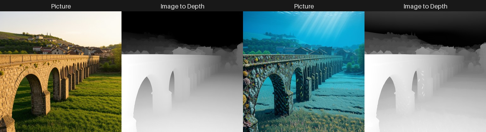
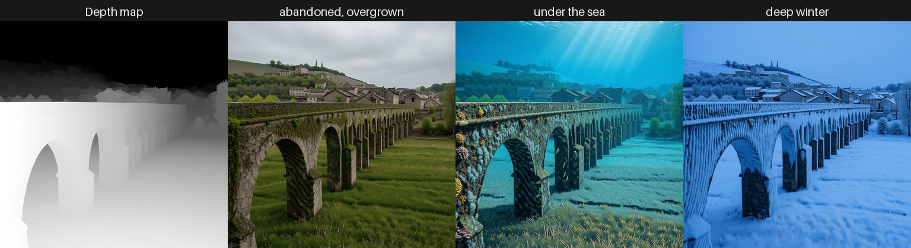

# 🌊 Iris-Z for Forge Neo

<div align="center">

[](https://github.com/Haoming02/sd-webui-forge-classic/tree/neo)
[](https://gradio.app/)
[](https://github.com/eduardoabreu81/iris-z-forge-neo)
[](LICENSE)

> **Extension for [Stable Diffusion WebUI Forge - Neo](https://github.com/Haoming02/sd-webui-forge-classic/tree/neo)**

</div>

Generate with **[Iris-Z](https://huggingface.co/speridlabs/iris-z)** inside Forge Neo, using the checkpoint, preset and Generate button you already know - one model that paints images, reads their depth, and repaints a scene from its depth, built on FLUX.2 [klein] 9B.

> [!Important]
> This extension requires an up-to-date **Forge Neo** (the `neo` branch). On an older version it stays disabled and tells you so in the console - Forge Neo itself keeps working as usual.

---

## 📋 Table of Contents

- [What's New](#-whats-new)
- [Features](#-features)
- [Installation](#-installation)
- [Recommended Settings](#%EF%B8%8F-recommended-settings)
- [Tips](#-tips)
- [Credits](#-credits)

---

## 🆕 What's New

### v0.2.0 - Depth to Image and Lighter Checkpoints

- **Depth to Image** - repaint a scene from its depth map with a new prompt, in img2img.
- **INT8 ConvRot and W4A8 checkpoints** - [Iris-Z-small in 9.4 GB and 5.6 GB](https://huggingface.co/eduardoabreu81/iris-z-small-quantized), with practically the same pictures.
- **Tested on a GPU** - text to image, Image to Depth and Depth to Image, with the bf16, INT8 and W4A8 checkpoints and four text encoders.

### v0.1.0 - First Release

- **Iris-Z-small in Forge Neo** - text-to-image through the usual txt2img tab.
- **Image to Depth** - the depth map of any picture, in img2img.
- **iris_z UI preset** - sampler, schedule, steps and CFG ready to generate.

---

## 🎯 Features

### 🖼️ Text to Image

<p align="center"></p>

- Runs inside txt2img - no separate tab, no extra environment
- Uses the same text encoder and VAE as FLUX.2 [klein] 9B - if you have Klein 9B, you already have them
- The bf16, INT8 ConvRot and W4A8 checkpoints give practically the same picture for the same seed
- Live preview, batches and LoRAs typed in the prompt work as with any other model

### 🌊 Image to Depth

<p align="center"></p>

- **Iris-Z** accordion in img2img → **Image to Depth**
- A greyscale depth map of any picture, near is bright - ready for depth ControlNets
- 4 steps, returned at the picture's own size

### 🎨 Depth to Image

<p align="center"></p>

- **Iris-Z** accordion in img2img → **Depth to Image**
- Put a depth map as the input image and describe the new look in the prompt - the picture keeps the shapes and layout of the scene
- Works with the maps **Image to Depth** makes, or any depth map where near is bright

### 🛡️ Safe by Design

- Changes no Forge Neo file - remove the extension and everything is as it was
- Checks your Forge Neo at startup and stays disabled if something it needs is missing
- Other models, plain FLUX.2 [klein] included, are not affected

---

## 📦 Installation

1. Open Forge Neo WebUI
2. Go to **Extensions** → **Install from URL**
3. Paste: `https://github.com/eduardoabreu81/iris-z-forge-neo`
4. Click **Install** and restart the WebUI
5. Place the files in the usual folders:

| Part | File | Folder |
| :--- | :--- | :--- |
| Iris-Z checkpoint | [`iris-z-small_int8_convrot`](https://huggingface.co/eduardoabreu81/iris-z-small-quantized) (9.4 GB), [`iris-z-small_w4a8`](https://huggingface.co/eduardoabreu81/iris-z-small-quantized) (5.6 GB) or `iris-z-small_bf16` (18.2 GB, see below) | `models/Stable-diffusion` |
| Qwen3 8B text encoder | [`qwen_3_8b`](https://huggingface.co/Comfy-Org/Flux-2-Klein-9B/tree/main/split_files/text_encoders) or the lighter `qwen_3_8b_fp8mixed` | `models/text_encoder` |
| FLUX.2 VAE | [`flux2-vae`](https://huggingface.co/Comfy-Org/Flux-2-Klein-9B/tree/main/split_files/vae) | `models/VAE` |

6. Pick the **iris_z** UI preset, the checkpoint, and the text encoder and VAE under **VAE / Text Encoder**

> [!Note]
> The original bf16 Iris-Z is published in four parts. To use it, download the **Iris-Z-small** folder from [speridlabs/iris-z](https://huggingface.co/speridlabs/iris-z/tree/main/Iris-Z-small) and join it into one checkpoint with the script that comes with this extension:
>
> ```
> python extensions/iris-z-forge-neo/tools/join_shards.py <the Iris-Z-small folder> models/Stable-diffusion/iris-z-small_bf16.safetensors
> ```
>
> Iris-Z-big (32B) is not supported: Forge Neo has no loader for its text encoder.

---

## ⚙️ Recommended Settings

| Use | Sampler | Schedule type | Steps | CFG |
| :--- | :--- | :--- | :--- | :--- |
| **Images** and **Depth to Image** | Euler | Flux2 | 50 | 4 |
| **Image to Depth** | set by the extension | - | - | - |

Leave the **negative prompt** empty. Iris-Z was trained at 512 and 1024: use 1024x1024 or about one megapixel with sides a multiple of 16, or 512x512 for quick drafts.

---

## 💡 Tips

- Iris-Z generates each image together with a depth layer, so it takes longer than FLUX.2 [klein] 9B at the same size
- **INT8 ConvRot** is the closest to the original; **W4A8** is the smallest, and runs at full speed on RTX 30 series cards or newer - on older cards choose INT8
- The **fp8mixed** text encoder gives practically the same pictures as the full one; the INT8 and fp4 text encoders also work, but change the composition more
- For **Image to Depth**, write nothing in the prompt, or only a LoRA tag - the text is ignored
- **Image to Depth** works at 512 on pictures under half a megapixel and at 1024 above, then returns the map at the picture's size
- **Depth to Image** works at about one megapixel with the depth map's proportions, whatever the size of the map
- So far Iris-Z has been tested on a 48 GB GPU; tests on 8 GB cards are coming
- Before uninstalling, switch the UI preset to another one

---

## 📄 Credits

- **[Forge Neo](https://github.com/Haoming02/sd-webui-forge-classic/tree/neo)** by Haoming02
- **[Iris-Z](https://huggingface.co/speridlabs/iris-z)** by SperidLabs - the model and its [reference code](https://github.com/speridlabs/iris-z-sdk)
- **[FLUX.2](https://github.com/black-forest-labs/flux2)** by Black Forest Labs - the model Iris-Z is built on
- **[Merge Studio](https://github.com/eduardoabreu81/sd-webui-merge-studio)** - made the INT8 ConvRot and W4A8 checkpoints

---

## 📜 License

AGPL-3.0 - see [LICENSE](LICENSE). The Iris-Z weights, the quantized ones included, are under the [FLUX Non-Commercial License](https://huggingface.co/black-forest-labs/FLUX.2-dev/blob/main/LICENSE.txt).

---

<div align="center">

Made with ❤️ for the Stable Diffusion community

**[Report Bug](https://github.com/eduardoabreu81/iris-z-forge-neo/issues)** • **[Request Feature](https://github.com/eduardoabreu81/iris-z-forge-neo/issues)** • **[☕ Ko-fi](https://ko-fi.com/eduardoabreu81)**

</div>
